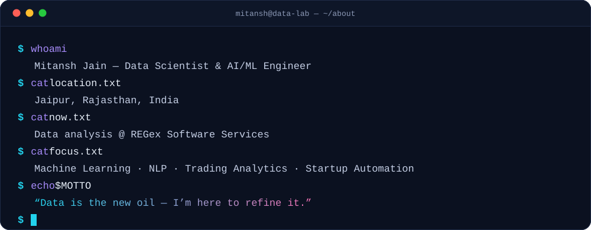
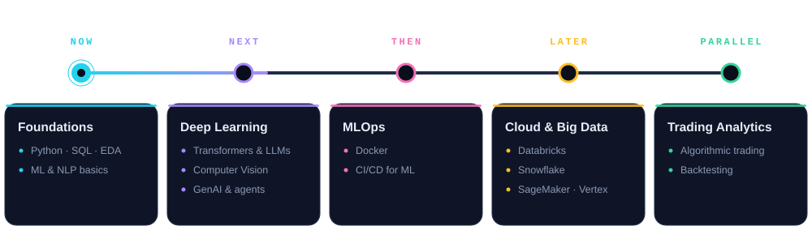

 

 

 

 

<table>
<tr>
<td width="50%"></td>
<td width="50%"></td>
</tr>
<tr>
<td width="50%"></td>
<td width="50%"></td>
</tr>
</table>

 

 

&nbsp;

  

  

 

<picture>
  <source media="(prefers-color-scheme: dark)" srcset="https://raw.githubusercontent.com/Mitanshjain/Mitanshjain/output/github-snake-dark.svg"/>
  <source media="(prefers-color-scheme: light)" srcset="https://raw.githubusercontent.com/Mitanshjain/Mitanshjain/output/github-snake.svg"/>
  
</picture>

 

Open to **data science, analytics and AI/ML roles**, and always up for open source or startup collaborations.

&nbsp;&nbsp;
&nbsp;&nbsp;

 

